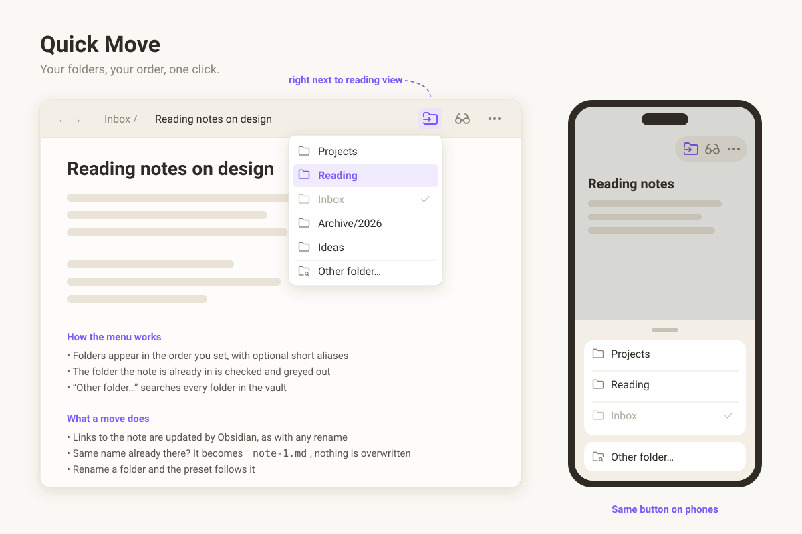

# Quick Move

Moving a note in Obsidian means right-click → *Move file to…* → type the folder
name, every time, even though most notes end up in the same handful of folders.

Quick Move puts a **Move to…** button in the note header, right next to the
reading-view button. Click it and you get a menu of *your* folders, in *your*
order. Pick one and the note moves.

## Features

- **Your own list of folders.** Add them in settings, reorder them with the
  up/down arrows, and give long paths a short alias (`Areas/Reading/2026` →
  `Reading`).
- **Where the note is now** is shown with a check mark and greyed out.
- **Other folder…** at the bottom of the menu searches every folder in the
  vault, for the occasional one-off move. It doesn't depend on the core
  *Files* plugin, so it still works if you use another file explorer.
- **Links stay intact.** The move goes through Obsidian's own rename, so with
  *Automatically update internal links* on, every link to the note is updated.
- **Nothing is overwritten.** If the target folder already has a note with the
  same name, the moved note becomes `name-1.md` and a notice tells you.
- **Rename a folder** in the vault and the preset follows it.
- **Works on phones and tablets.** The same button sits in the mobile header
  and the menu opens as a bottom sheet.
- A command, **Quick Move: Open move menu**, for a hotkey or the mobile toolbar.
- English and Chinese interface, following Obsidian's language.

## Use cases

- Triage an inbox: read a note, send it to Projects, Reading or Archive in one click.
- File notes on your phone without digging through the folder tree.
- Keep a short list of today's active folders at the top of the menu.

## Install

Search for **Quick Move** in Settings → Community plugins, or copy `main.js`,
`manifest.json` and `styles.css` from the latest release into
`<vault>/.obsidian/plugins/quick-move/`.

Then open Settings → Quick Move and add your folders.

## License

MIT
